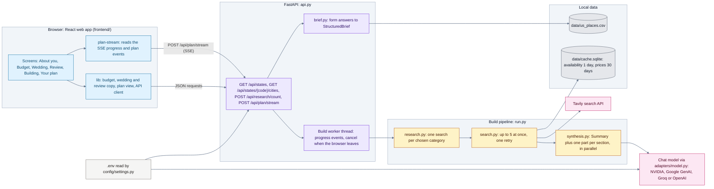
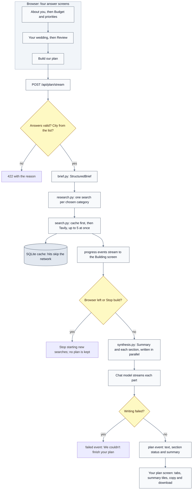

# Vows n Knots


Vows n Knots is a wedding planner. The couple answers four short screens about their wedding. The app then searches the web for venues, vendors, costs and transport, and writes a plan that says where each figure came from. It is a FastAPI backend with LangChain and Tavily search, and a React web app.

Version 0.2.0 replaces the earlier sub-agent design. The research is planned in code, and the chat model only writes the plan.

## Screens

- **Welcome**: a short introduction and the Plan our wedding button.
- **About you**: couple names, state and city (picked from a list of US census places), wedding date as an exact day or a month, guest count and currency.
- **Budget and priorities**: a total budget range and up to eight priorities. Choosing more than three priorities adds searches and makes the build longer, and the screen says so.
- **Your wedding**: style, dietary needs, venue setting, maximum travel from downtown, and traditions and family details.
- **Review**: the answers, each with an Edit link, and the Build our plan button.
- **Building**: live progress for each category (venues, caterers, photographers, music, transport, budget), the time left, and a Stop build button that asks for confirmation.
- **Your plan**: four summary tiles (budget midpoint per guest, venues shortlisted, estimated total, days to go), one tab per section, and Download, Copy and Start again actions.

## Project Structure

```
vows-n-knots/
├── main.py                        # Terminal runner: python main.py
├── pyproject.toml                 # Package metadata (version 0.2.0) and Python dependencies
├── uv.lock                        # Locked Python dependencies
├── .env.example                   # Template for environment variables
├── .env                           # Your local keys (gitignored, create from .env.example)
├── data/
│   ├── us_places.csv              # US census places for the City list
│   └── cache.sqlite               # Search cache (created at runtime, gitignored)
├── scripts/
│   └── build_places_snapshot.py   # Rebuilds data/us_places.csv
├── logs/                          # Rotating application log (created at runtime, gitignored)
├── docs/
│   ├── UX.md                      # Screens, states and behaviour, with the Doop wireframe numbers
│   └── superpowers/               # Design specs and the backend research plan
├── src/vows_n_knots/
│   ├── api.py                     # FastAPI app: states, cities, research count, plan stream (SSE)
│   ├── brief.py                   # Turns the form answers into a StructuredBrief
│   ├── locations.py               # Loads and matches the census places
│   ├── research.py                # Plans the web searches from the priorities
│   ├── search.py                  # Runs the searches: cache, concurrency, one retry, Tavily
│   ├── cache.py                   # SQLite search cache with a lifetime per kind of fact
│   ├── synthesis.py               # Writes the plan with the chat model, one part per section
│   ├── run.py                     # One build: research, writing, progress and cancel
│   ├── prompts.py                 # Instructions for the writing model
│   ├── sample_brief.py            # Sample answers for the terminal runner
│   ├── main.py                    # Terminal entry point
│   ├── adapters/
│   │   └── model.py               # Chat model by provider (LangChain init_chat_model)
│   └── config/
│       ├── settings.py            # Provider, model and log settings from the environment
│       ├── research.py            # Cache lifetimes, concurrency, retries and token limits
│       └── logging_config.py      # Stdout and rotating file logging
├── frontend/
│   ├── src/
│   │   ├── App.tsx                # Step flow across the seven screens
│   │   ├── screens/               # One file per screen, with its tests
│   │   ├── components/            # App components and shadcn/ui primitives
│   │   ├── lib/                   # Form schemas, plan streaming (SSE), API client, plan view
│   │   ├── i18n/                  # en.json copy with typed keys
│   │   └── test/                  # Test setup
│   ├── vite.config.ts             # Dev server; /api is proxied to 127.0.0.1:8000
│   └── package.json               # Web app scripts and dependencies
└── tests/                         # Backend unit tests (unittest)
```

## Architecture

### Component diagram

The browser calls the API over JSON and server-sent events. The API turns the answers into a brief and runs one build. The build plans the searches in code, runs them through Tavily with the SQLite cache, and sends the research to the chat model for writing.



### Flow chart

A build starts when the couple presses Build our plan on the Review screen. It ends with a plan on the Your plan screen, or with a plain failure message.



### Flow summary

1. **Answer**: the couple fills in four screens. The City list only accepts places from the census file, and each screen checks its own answers.
2. **Build request**: the Review screen posts the answers to `/api/plan/stream`. The server validates them into a brief and returns a 422 with the reason if they are not valid.
3. **Plan the research**: `research.py` turns the chosen priorities into a fixed list of searches. The search count shown on the Review screen comes from the same rule, so the two cannot drift apart.
4. **Search**: each search checks the SQLite cache first. A miss goes to Tavily, with up to five searches at once and one retry. Availability results are kept for a day, and price results for thirty days.
5. **Write**: the Summary and each section are written by the chat model in parallel, from the research for that section. The Summary sees all the research.
6. **Stream**: progress events go to the Building screen as they happen. The plan arrives as one final event, with the text, the status of each section (for example "no data") and the timings.
7. **Stop**: pressing Stop build, or closing the page, stops new searches and drops the build. Searches already in flight finish, and their results are cached.
8. **Errors**: a failed build shows "We couldn't finish your plan." with the research kept, so a retry is quicker.

## Prerequisites

- Python 3.13+
- [uv](https://docs.astral.sh/uv/) for the Python environment
- Node.js (LTS) for the web app
- A Tavily API key, and an API key for at least one chat provider: NVIDIA, Google GenAI, Groq or OpenAI

## Setup

```bash
uv sync                     # Python dependencies
cd frontend && npm install  # Web app dependencies
cp .env.example .env        # Then add a provider key and TAVILY_API_KEY
```

Edit `.env` and set:

| Variable | Description | Required |
|----------|-------------|----------|
| `LLM_PROVIDER` | Chat provider: `nvidia`, `google_genai`, `groq` or `openai` | No (default: `nvidia`) |
| `NVIDIA_MODEL` | NVIDIA model name | No (default: `nvidia/nemotron-3-ultra-550b-a55b`) |
| `GOOGLE_MODEL` | Gemini model name | No (default: `gemini-3.1-flash-lite`) |
| `GROQ_MODEL` | Groq model name | No (default: `llama-3.1-8b-instant`) |
| `OPENAI_MODEL` | OpenAI model name | No (default: `gpt-4o-mini`) |
| `NVIDIA_API_KEY` | NVIDIA API key (from https://build.nvidia.com) | Key for the chosen provider |
| `GOOGLE_API_KEY` | Google Gemini API key (from https://aistudio.google.com/apikey) | Key for the chosen provider |
| `GROQ_API_KEY` | Groq API key (from https://console.groq.com/keys) | Key for the chosen provider |
| `OPENAI_API_KEY` | OpenAI API key (from https://platform.openai.com/api-keys) | Key for the chosen provider |
| `TAVILY_API_KEY` | Tavily API key for web search (from https://app.tavily.com) | Yes |
| `LOG_LEVEL` | `DEBUG`, `INFO`, `WARNING`, `ERROR` or `CRITICAL` | No (default: `INFO`) |

Never commit `.env`; it is already listed in `.gitignore`.

## Running the App

Run the API and the web app in two terminals.

```bash
# Terminal 1: the API on port 8000
uv run uvicorn vows_n_knots.api:app --port 8000

# Terminal 2: the web app on http://localhost:5173
cd frontend && npm run dev
```

Open http://localhost:5173. The Vite dev server forwards `/api` to the API on port 8000.

The terminal runner asks for the couple's requirements and prints a plan:

```bash
uv run python main.py
```

## Running Tests

```bash
# Backend: 152 unit tests
uv run python -m unittest discover -s tests -t .

# Web app: 274 tests, with coverage thresholds
cd frontend && npm run test:coverage
```

The test badges reflect the last local run. The repository has no CI workflow yet.

## Configuration

Settings are read from `.env` by `config/settings.py`. The research settings in `config/research.py` are fixed in code:

| Setting | Value | Meaning |
|---------|-------|---------|
| Availability cache | 1 day | Venues, vendors and transport |
| Price cache | 30 days | Budget categories |
| Concurrency | 5 | Searches running at once |
| Retries | 1 | Retries of a failed search |
| Results per search | 5 | Tavily results kept |
| Synthesis timeout | 600 seconds | Limit for writing the plan |
| Cost reference year | 2026 | Year the budget prices refer to |

## Documentation

- [docs/UX.md](docs/UX.md) describes each screen, its states and the rules behind them.
- [docs/superpowers/specs/](docs/superpowers/specs/) holds the design specs for the backend research and the couple flows.

## License

This project is licensed under the MIT License. See the [LICENSE](LICENSE) file for details.

### Summary

| Aspect | Details |
|--------|---------|
| **License** | MIT License |
| **Copyright** | 2026 Vidhaata Labs (Karthik Prabhu K) |
| **Permissions** | Commercial use, distribution, modification, private use |
| **Limitations** | No warranty, no liability |
| **Conditions** | Include copyright and license notice in copies |

The software is provided "as is", without warranty of any kind. The authors or copyright holders are not liable for any claims, damages, or other liability arising from the use of this software.
