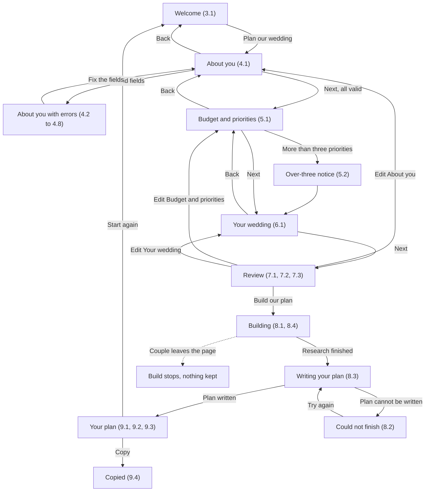
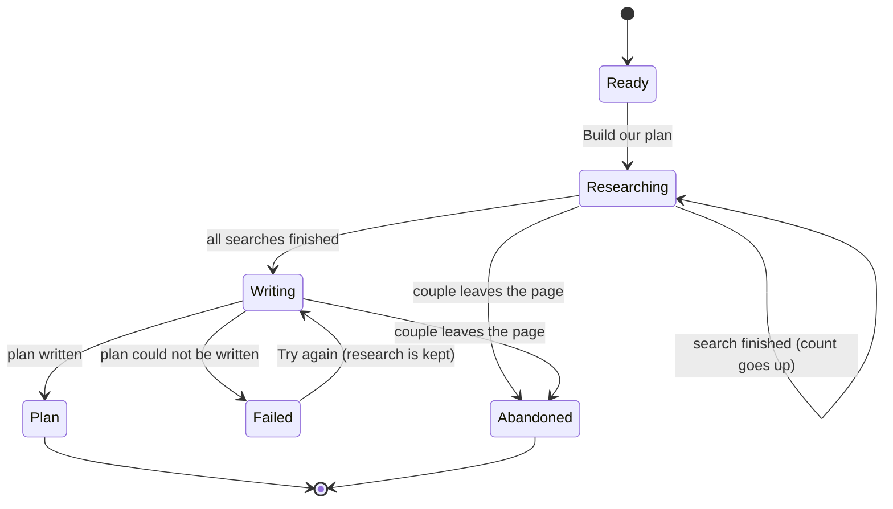

# UX: Vows n Knots frontend flows

- **Status:** Draft, for review with the wireframes on the Doop canvas.
- **Canvas:** Vows n Knots (Doop), id `rhwwfz0k7H`. Page and frame numbers below match the canvas.
- **Builds on:** [design system](superpowers/specs/2026-11-21-design-system-design.md) and [couple flows](superpowers/specs/2026-11-21-couple-flows-design.md). The backend is the code-planned research merged in PR #2.
- **Persona:** a couple planning their own wedding. Plain language, no planner jargon.

## 1. Principles

- **Plain language.** No planner terms. Say what a number means where it appears.
- **Nothing hidden.** Missing data and waits are stated, never dropped.
- **No storage layer.** A plan lives in the browser session only. Closing the tab loses it.
- **Frontend-only layout.** The plan is laid out in the frontend. The backend returns markdown and section statuses.
- **Pointer.** Anything the couple can click shows a pointer cursor: buttons, chips, tabs, options, the calendar days, and the Edit links. Disabled controls show a not-allowed cursor. Text fields keep the text cursor.
- **Desktop and phone.** The wireframes are 1280 pixels wide. Below 640 pixels the screens use one column (section 9, item 4).

## 2. Flow overview

Seven steps, with branches for errors, the over-three priority notice, editing and failure.

## 3. Build lifecycle

The build is the only long wait (about three minutes). This diagram covers the states the couple sees.

A section with no current figures does not fail the build. It shows in the plan as a muted card (see section 7).

## 4. Screens

Field rules are the source of truth for validation. The backend `brief` module enforces the same rules and returns a `BriefError` for anything it rejects.

### 4.1 Welcome (3.1)

- One sentence, the "Plan our wedding" button.
- States the three-minute wait here, so it is no surprise later.

### 4.2 About you (4.1 to 4.8)

| Field | Input | Rule | Error text |
| --- | --- | --- | --- |
| Couple names | Text | Used as the plan title. Required. | Shown under the field if empty. |
| State | Picker, 50 states and DC | Required. | Required. |
| City | Searchable list for the chosen state | Only Census cities. Typed names cannot be used. | "Pick a city from the list. Typed cities can't be used." |
| Wedding date | Toggle: Exact date or Month only | Exact date must be later than today. Month only must be the current month or later. | "Exact date must be later than today." / "Month only must be the current month or later." |
| Guest count | Number | 10 to 1,000. | "Guest count must be between 10 and 1,000." |
| Currency | Select | USD by default. Options: USD, EUR, GBP, CAD, AUD. | None. |

Notes:

- Errors appear next to each field before the couple moves on.
- The city list is searchable and only shows cities in the chosen state. A search with no match says so (4.7).
- Season and year are derived from the date in the backend, as they are now.

### 4.3 Budget and priorities (5.1 to 5.4)

- **Budget:** range slider from $5,000 to $250,000, in steps of $5,000. Two handles set the low and high ends.
- **Midpoint:** shown under the slider as "About $X per guest, from your range", where X is the midpoint of the range divided by the guest count.
- **Priorities:** any number of the eight options. Chips toggle on and off. Zero is allowed (5.3).
- **Over three:** when more than three are chosen, an alert says that the extra research adds time to the build (5.2). The Review screen repeats this.

The eight priorities: Venue shortlist, Vendor research, Budget allocation, Guest experience, Timeline, Design direction, Risk management, Travel logistics.

### 4.4 Your wedding (6.1, 6.2)

- **Style:** chips, several allowed. Ten options: Modern, Romantic, Classic, Garden, Minimal, Luxury, Cultural fusion, Destination, Eco-conscious, Black tie.
- **Dietary needs:** chips. Vegetarian, Vegan, Gluten-free, Halal, Kosher, Other.
- **Venue setting:** one choice. Indoor, Outdoor, Indoor-outdoor.
- **Maximum travel from downtown:** one choice. 30, 45, 60, or 90 minutes.
- **Traditions and family details:** free text, optional. Covers traditions and anything to avoid.
- **Tone:** not shown. The plan uses a warm, practical tone by default.

### 4.5 Review (7.1, 7.2, 7.3)

- One card per section (About you, Budget and priorities, Your wedding). Each card has an "Edit" link back to its step.
- When more than three priorities are chosen, an alert shows the extra time and the number of searches. The number is `count_research_searches(brief)` from the backend research plan, so it matches the build. The wireframe shows four priorities (Venue shortlist, Vendor research, Budget allocation, Travel logistics), which gives 15 searches.
- A notice above the button says the build takes about three minutes, that the page must stay open, and that leaving stops the build and keeps nothing.
- One button: "Build our plan."
- **Gate:** until a venue setting and a maximum travel time are chosen, the button is disabled and "Choose a venue setting and a maximum travel time before building." shows above it (7.4).
- **Nothing chosen:** "No priorities chosen", "No styles chosen" and "No preferences chosen" (7.4). Approved copy.
- A month-only date shows as "July 2027" (7.3).

### 4.6 Building (8.1, 8.2, 8.3, 8.4)

- **Progress:** a percentage bar, an estimate in minutes, and one tile per category: Venues, Caterers, Photographers, Music, Transport, Budget.
- **Tile states:** Waiting, Searching, "N found", "No current figures".
- **Status:** under the bar, a note says the page must stay open: "Keep this page open while we build. Closing it stops the build." There is no separate step list, since the title and the bar already show the stage. Search queries are never shown.
- **Failure:** if the plan cannot be written, the couple sees "We couldn't finish your plan", the message "Writing the plan failed. Your research is saved, so a retry is quicker.", and a "Try again" button. Tiles that found research stay visible.
- **Leaving the page:** the browser shows its own "leave site?" prompt while a build runs. If the couple leaves, the server stops the research: searches not yet started are skipped, and searches already running finish and are kept in the cache. Nothing is kept as a plan. The Review notice says so before the build starts.
- **Stop build:** a ghost button under the progress. It opens our own dialog ("Stop building your plan?") with "Keep building" and "Stop build", over the building page, which is blurred behind it. Confirming returns to Review. The server stops the same way as when the page is left.
- **Stop during writing:** the model calls are streamed, so a stop while the plan is being written closes every call at once. The server stops generating and drops the partial text (8.3, 8.4). The Stop build button is on 8.1, 8.3 and 8.4; the dialog is 8.5.

### 4.7 Your plan (9.1 to 9.4)

- **Heading and actions:** the names, place, date and guest count on the left. Download, Copy and Start again on the right, on the same row, above the tabs.
- **Summary strip:** four compact tiles, each with a label, a one-line value and a note: budget midpoint per guest, venues shortlisted with the travel limit, estimated total (the midpoint of the range), and days until the wedding. The values are smaller than the section titles.
- **Tabs:** the sections are tabs under the summary tiles, one tab per section, with the open tab underlined. Only the open section shows.
- **Scrolling:** the page fits the window, so the heading, actions, tiles and tabs stay in place. The section card itself scrolls, so its rounded corners frame the scrollbar. The section heading is pinned at the top of the card while the content scrolls beneath it. The scrollbar is translucent and stays out of sight at rest. It appears while the couple hovers the card, and for about 0.8 seconds after any scroll (wheel, trackpad or keyboard), then fades back to clear.
- **Type:** section titles at 22px, sub-headings at 16px, and content at 14px. Labels are 13px.
- **Sections:** each section's content is in its tab, with an icon beside its title. The model's text is split into blocks in the frontend. Summary comes first; the other sections follow the brief's order.
- **Tables:** the first two columns (for example the category and its allocation) stay on one line. The remaining columns, such as notes, wrap. A table has no scrollbar of its own: the section card is the only scrolling part, so its rounded edges frame the one scrollbar.
- **Prices:** every price has its source and retrieval date under it, in the table.
- **Sections without data:** muted cards that say "We couldn't find current figures for this section." The plan still shows the rest.
- **Actions:** Download, Copy, and Start again, at the top right. Copy shows a confirmation.

## 5. Copy

All copy the couple sees is in `frontend/src/i18n/en.json`, under screen keys such as `about.title` and `review.gate`. Components read it with `t()`. Tests assert on the same keys, so a wording change is one edit in that file. Priority, style, dietary and venue values sent to the API are not translated; only their labels are.

| Where | Text |
| --- | --- |
| Welcome | "Venues, vendors, budget and a timeline, each with its price and source. It takes about three minutes." |
| Section with no figures | "We couldn't find current figures for this section." |
| Build could not finish | "We couldn't finish your plan." / "Writing the plan failed. Your research is saved, so a retry is quicker." |
| Review notice | "The build takes about three minutes. Keep this page open: leaving stops the build, and nothing is kept." |
| Over three priorities | "Four priorities mean {N} searches. Choosing more than three adds research and makes the build longer." where N = `count_research_searches(brief)`. |
| Copy confirmation | "Plan copied. You can paste it into an email or a document." |

The count comes from the research plan. The count depends only on which priorities are chosen: Venue shortlist 1, Vendor research 3, Budget allocation 10, Travel logistics 1, and Timeline, Guest experience, Design direction and Risk management add none. The Review wireframe was previously marked "about 14"; the correct figure for its four priorities is 15.

## 6. Backend impacts

These changes were needed for the flows above. All four are built.

1. **Month-only date.** Built. The API accepts a full date or a month (`YYYY-MM`). The brief keeps the precision, and season and year come from the month.
2. **Structured dietary, venue and travel.** Built. The brief takes the chips directly when given (`dietary`, `venue_setting`, `max_travel_minutes`), and falls back to the old text parsing otherwise.
3. **Tone.** The API sends "Warm and practical" as the tone. The synthesis prompt uses it as given.
4. **Progress detail.** Built. Progress events carry the section and category, so the build can group steps into tiles. Search queries are never sent to the browser.

Frontend-only items: the over-three alert, the plan layout, and session storage.

## 7. Screen states on the canvas

| Page | Frame | State |
| --- | --- | --- |
| 1 Design System | 1.1 Design system overview | Icon, colours, type, every component |
| 2 Components | 2.1 to 2.18 | Component masters |
| 3 Welcome | 3.1 Welcome | Default |
| 4 About you | 4.1 About you | Filled, valid |
| 4 About you | 4.2 About you, with errors | Exact date in the past, no city, guests too few |
| 4 About you | 4.3 About you, month only | Month only |
| 4 About you | 4.4 About you, month in the past | Month only error |
| 4 About you | 4.5 About you, guests over 1,000 | Guests error |
| 4 About you | 4.6 About you, city list open | Searchable list with matches |
| 4 About you | 4.7 About you, no city matches | City error |
| 4 About you | 4.8 About you, field in focus | Focus state |
| 5 Budget and priorities | 5.1 Budget and priorities | Three priorities chosen |
| 5 Budget and priorities | 5.2 Budget and priorities, over three | Four priorities, alert |
| 5 Budget and priorities | 5.3 Budget and priorities, nothing chosen | No priorities |
| 5 Budget and priorities | 5.4 Budget and priorities, full range | $5,000 to $250,000 |
| 6 Your wedding | 6.1 Your wedding | Choices made |
| 6 Your wedding | 6.2 Your wedding, nothing chosen | No choices, empty notes |
| 7 Review | 7.1 Review | Four priorities, build notice |
| 7 Review | 7.2 Review, three priorities | No alert |
| 7 Review | 7.3 Review, month-only date | Month only shown in the card |
| 8 Building | 8.1 Building | Running, some tiles waiting |
| 8 Building | 8.2 Building, failed | Could not finish, Try again |
| 8 Building | 8.3 Building, writing the plan | All research done |
| 8 Building | 8.4 Building, no figures for one category | Budget with no figures |
| 9 Your plan | 9.1 Your plan | Two sections, one muted |
| 9 Your plan | 9.2 Your plan, all sections with data | Every section, Budget active in sidebar |
| 9 Your plan | 9.3 Your plan, sections without data | Three muted sections |
| 9 Your plan | 9.4 Your plan, copied | Copy confirmation |

## 8. Components used

The screens are built from the components on page 2. Each is a shadcn/ui base restyled with the tokens, except the custom ones listed in the design system spec.

- Button (primary, ghost), Input, Select (with a chevron), Segmented (Exact date or Month only), Slider (two handles; `range` = `default` or `full`), Chip (`state` = `off` or `on`), Card, Alert, CategoryTile, SummaryTile, PlanTab (`state` = `active` or `idle`, with a section icon and `label`), PlanSection, PlanTable, Header, Footer. The Tag, Stepper and ProgressStep components were removed, because the app does not use them.

## 9. Open items

Resolved:

1. **Progress grouping.** The build shows one tile per section. Each progress event carries its section and category (option 2). Search queries are never sent to the browser.
2. **Plan text split.** Each `##` heading starts a section. `###` lines, lists and pipe tables are kept. Text before the first heading is a Summary section, and horizontal rules are dropped. The rule is in `frontend/src/lib/plan-view.ts`. Checked against one real plan.
3. **Search count in the frontend.** `POST /api/research/count` takes the priorities and returns the count from the research plan. A test checks the count for every combination of priorities.
4. **Phone layout.** Decided: two-column content collapses to one column below 640 pixels, the plan's sidebar stacks below 768 pixels, and the side gutter is 16 pixels. Every screen in the flow was checked at 390 pixels with no horizontal overflow. Not checked on a real device.
5. **Slider in a browser.** The shadcn slider sets both handles in headless Chrome, including from the keyboard, and the full-range state was checked.
6. **Approval.** The flows and the React setup were approved in conversation, and the project is scaffolded in `frontend/`.
7. **API layer.** FastAPI with uvicorn. Endpoints are in `src/vows_n_knots/api.py`.
8. **Month-only date.** Built. The API accepts a full date or a month (`YYYY-MM`). The brief keeps the precision, and season and year come from the month.
9. **Double build in development.** Fixed. The build starts from the Build button, not from an effect, so one request is sent even in React's development mode.
10. **Leaving the build.** Built. Leaving the page (or confirming Stop build) cancels the build on the server. The research step checks the cancel flag before each search, so no new searches start. Searches already running finish and are cached. A cancel before the model call skips synthesis. The cancel was checked with a real build: the tab closed 0.6 seconds in, the server logged the cancel, and no errors were logged. The browser shows its leave prompt during a build, and the Stop build dialog returns to Review.

11. **Real builds, end to end.** The plan is now written as parallel parts: a Summary, then one part per priority, joined in brief order. One real run with the sample couple took 52.6 seconds on the server (research 5.5 s, writing 46.7 s), against a target of under 3 minutes. Before the change, the same couple took about 158 seconds. This is one run; more runs should confirm it.
12. **Summary in the sidebar.** Kept, and drawn in the wireframes (9.1 to 9.4).
13. **Copy.** Approved by the owner, and drawn in the wireframes: "No priorities chosen", "No styles chosen", "No preferences chosen", the venue and travel gate (7.4), and the Stop build dialog (8.5).
14. **Stopping during writing.** Built. The model calls are streamed, and a stop closes them at once. Checked with a real build: the server logged "Build cancelled while writing the plan." in the same second as the stream closed, and no plan was finished.

No open items remain in this list.

## 10. Not in scope

- Dark mode.
- Accounts, saved plans, or any storage beyond the browser session.
- Vendor booking or payment.
- Locations outside the 50 states and DC.

## 11. Build status and parity notes

Status as of the first screen build:

- **Built:** About you (4.1 to 4.8) in `frontend/src/screens/about-you.tsx`, Budget and priorities (5.1 to 5.4) in `frontend/src/screens/budget-and-priorities.tsx`, Your wedding (6.1 and 6.2) in `frontend/src/screens/your-wedding.tsx`, Review (7.1 to 7.3) in `frontend/src/screens/review.tsx`, Building (8.1 to 8.4) in `frontend/src/screens/building.tsx`, Welcome (3.1) in `frontend/src/screens/welcome.tsx`, and Your plan (9.1 to 9.4) in `frontend/src/screens/your-plan.tsx`, with the header, footer and shell.
- **Not built:** none of the wireframed screens. The open items below remain.
- **Build gating:** Build our plan stays disabled until a venue setting and a maximum travel time are chosen. The message for that case is mine, not the wireframes', so it needs review. Month-only dates build.
- **Month-only dates:** the screen accepts a month, and the API now accepts it too (backend item 1).

Where the React screen differs from the wireframes:

- **State field (4.2):** the wireframe draws the State field with a red border but no message. A red border needs a message, so the React screen shows the border only when State has an error.
- **City results (4.6):** the wireframe shows three results for "Chi". Illinois also has Chillicothe, which the React list shows, because the list comes from the Census data.
- **Date controls:** the wireframe shows the chosen date as text. The React screen shows the same text, but picks it from a calendar (exact date) or a month grid (month only).
- **Past dates:** both pickers let the couple choose a past date, so the "later than today" and "current month or later" errors appear on Next, as in 4.2 and 4.4.
- **Dark mode:** off. Operating-system dark mode does not change the screens.
- **Background photo:** the wireframe's rose photo is saved as `frontend/public/backgrounds/roses.jpg`.
- **How parity was checked:** headless Chrome screenshots of each state, compared by eye with the wireframes. This is not a pixel diff.
- **Sample data:** the screen opens with the 4.1 sample couple (Amira & Noah, Chicago, 120 guests).

## 12. Tests

- **Backend:** from the project root, `python -m unittest discover -s tests -t .` (152 tests). Covers the brief, research plan, search cache and retries, the plan stream and cancel, and the streamed, parallel plan writing.
- **Frontend:** from `frontend/`, `npm run test` (Vitest, jsdom, React Testing Library; 94 tests). Covers the parsing and state modules in `src/lib`, the build hook, the leave-page prompt, and the Building, Review and Your plan screens.
- **Type check and build:** `npm run build` in `frontend/`.
